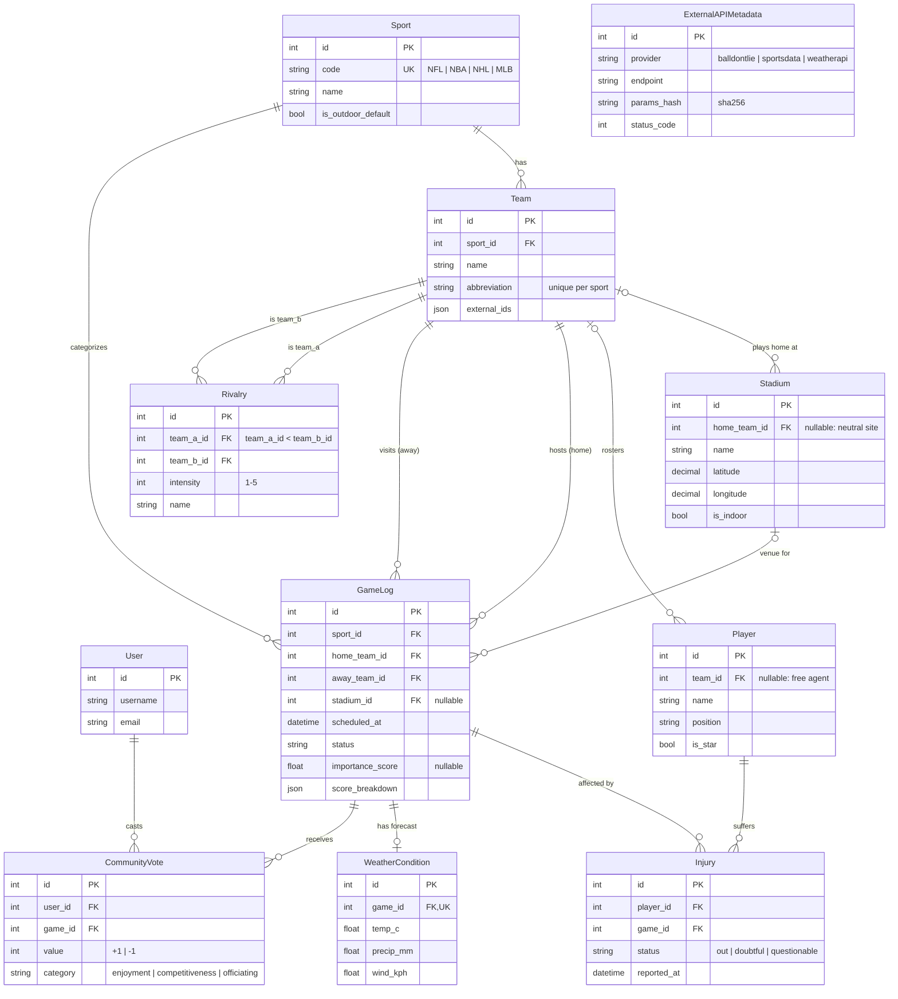

# Sportie database diagram: Community Game Ranker

Generated from `backend/apps/community_game_ranker/models.py` (migration `0001_initial_ranker_models`).

**Legend.** `||` = exactly one, `|o` = zero or one (nullable FK), `o{` = zero or many, `o|` = optional one-to-one.
`ExternalAPIMetadata` stands alone: it's a response cache and audit log keyed by (provider, endpoint, params_hash), with no FKs.
Unique constraints not drawn: Team (sport, abbreviation), Injury (player, game), Rivalry (team_a, team_b), CommunityVote (user, game, category).
