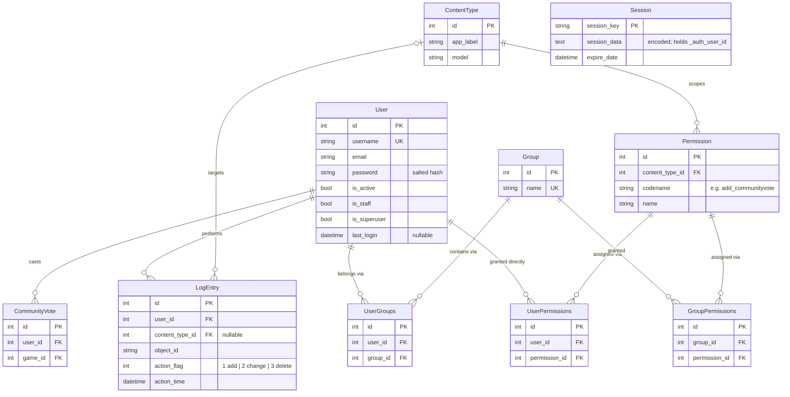

# Sportie database diagram: Django authentication and authorization

Built-in tables from `django.contrib.auth`, `contenttypes`, `sessions` and `admin`, as enabled in
`backend/config/settings.py`. No custom `AUTH_USER_MODEL` is set, so `User` is the stock `auth.User`.

**Legend.** `UserGroups`, `UserPermissions` and `GroupPermissions` are the many-to-many join tables
(`auth_user_groups`, `auth_user_user_permissions`, `auth_group_permissions`); each pair of FKs is unique.
`Session` has no real FK to `User`: the logged-in user's id lives inside the encoded `session_data`.
A user's effective permissions are their direct permissions plus those of every group they belong to;
`is_superuser` bypasses all checks.
